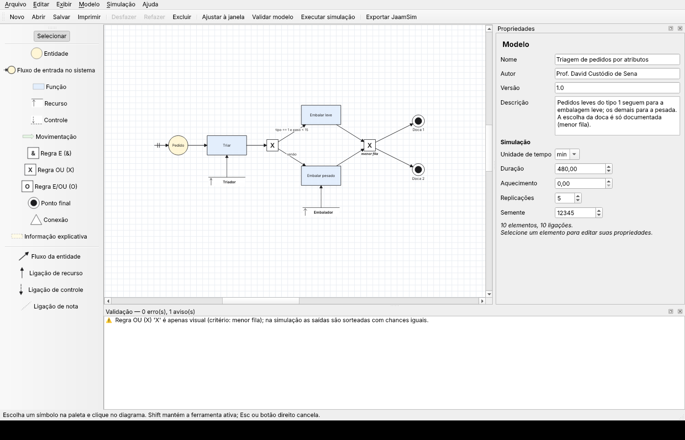

<p align="center"></p>

# IDEF-SIM Studio

Programa desktop para **criar, documentar, validar e simular** modelos conceituais
na técnica **IDEF-SIM** (Leal, Almeida & Montevechi, 2008), usada na
simulação a eventos discretos.

**⬇️ Baixar:** [versão mais recente para Windows, macOS e Linux](https://github.com/davidc-sena/idefsim-studio/releases/latest)



## Funcionalidades

| Área | O que faz |
|---|---|
| **Editor gráfico** | Paleta com todos os símbolos IDEF-SIM. Pode arrastar, encaixar na grade, dar zoom (Ctrl+roda), duplicar (Ctrl+D), excluir, desfazer e refazer. |
| **Propriedades** | Nome, descrição e parâmetros de cada elemento: chegadas, tempos, capacidades e probabilidades. |
| **Validação** (F7) | Erros e avisos em tempo real: elementos sem fluxo, distribuições inválidas, conectores sem par, probabilidades, elementos inalcançáveis… Clique em uma mensagem para ir ao elemento. |
| **Simulação** (F5) | Motor de eventos discretos (SimPy) que executa o próprio diagrama, com replicações, aquecimento, média, desvio padrão e IC 95%. Os resultados exportam para CSV. |
| **Gestão de modelos** | Arquivos `.idefsim` (JSON legível e versionável), metadados (autor, versão e descrição), arquivos recentes e modelos de exemplo. |
| **Exportação para JaamSim** | Gera um modelo **básico** do [JaamSim](https://jaamsim.com) (`.cfg`) a partir do diagrama IDEF-SIM: chegadas, filas, recursos, tempos, regras de decisão, montagem e saídas, já posicionados como no diagrama. |
| **Impressão e exportação limpa** | **Arquivo → Imprimir** (Ctrl+P, com pré-visualização) e **Exportar diagrama limpo** (PDF, PNG, SVG; Ctrl+Shift+E): sem grade nem marcas de edição, com opção de preto e branco, título/autor/data e rótulos das setas. A página (A4) fica deitada ou em pé conforme o formato do diagrama. |
| **Documentação** | Exportação do diagrama em PNG ou SVG e do dicionário do modelo conceitual em HTML (com o diagrama embutido). |

## Instalação e execução

```bash
git clone https://github.com/davidc-sena/idefsim-studio.git
cd idefsim-studio
python -m venv .venv
# Windows: .venv\Scripts\activate    Linux/macOS: source .venv/bin/activate
pip install -r requirements.txt
python main.py                       # ou: python main.py examples/usinagem_inspecao.idefsim
```

### Executáveis prontos (Windows, macOS, Linux)

O workflow `.github/workflows/build.yml` compila automaticamente os executáveis
em máquinas Windows, macOS e Linux do GitHub Actions:

* **A cada push**, os pacotes ficam em *Actions* → execução → *Artifacts*.
* **Ao enviar uma tag de versão** (`git tag idefsim-v0.2.0 && git push origin idefsim-v0.2.0`),
  é criado automaticamente um **Release público** com os quatro executáveis anexados.
* Downloads da versão mais recente: <https://github.com/davidc-sena/idefsim-studio/releases/latest>
* Também é possível rodar manualmente em *Actions* → *IDEF-SIM Studio - executáveis* → *Run workflow*.

| Sistema | Arquivo | Como instalar |
|---|---|---|
| Windows 10/11 (64 bits) | `IDEF-SIM-Studio-windows-x64.zip` | Extraia a pasta e execute `IDEF-SIM Studio.exe`. |
| macOS Apple Silicon (M1–M4) | `IDEF-SIM-Studio-macos-arm64.dmg` | Abra o `.dmg` e arraste o app para *Aplicativos*. |
| macOS Intel | `IDEF-SIM-Studio-macos-x64.dmg` | Igual ao anterior. |
| Linux 64 bits (Ubuntu 22.04+ e similares) | `IDEF-SIM-Studio-linux-x64.tar.gz` | `tar -xzf IDEF-SIM-Studio-linux-x64.tar.gz` e execute `IDEF-SIM Studio/IDEF-SIM Studio`. |

> **Aviso de segurança na primeira execução.** Os executáveis não têm assinatura digital
> paga, por isso o sistema pode exibir um alerta:
> * **Windows** (SmartScreen): clique em *Mais informações* → *Executar assim mesmo*.
> * **macOS** (Gatekeeper): clique com o botão direito no app → *Abrir* → *Abrir*. Se não
>   funcionar, rode `xattr -dr com.apple.quarantine "/Applications/IDEF-SIM Studio.app"`.

### Gerar o executável localmente

O PyInstaller gera o executável **do sistema em que é executado** (é preciso um Windows
para gerar o `.exe` e um Mac para o `.app`):

```bash
pip install -r requirements.txt pyinstaller pillow
pyinstaller --noconfirm packaging/idefsim_studio.spec
# resultado em dist/
```

O ícone (`idefsim/resources/icon.png`) e o logo (`docs/logo.png`) são gerados por
`python packaging/make_icon.py` a partir de `idefsim/gui/branding.py`. Para abrir o programa
sem a janela de abertura, use `python main.py --sem-abertura`.

### Testes

```bash
pip install pytest
python -m pytest
```

## Como modelar

1. Escolha um símbolo na paleta (ou use o atalho) e clique no diagrama. **Shift** mantém a ferramenta ativa; **Esc** ou o botão direito volta a *Selecionar*.
2. Para conectar dois elementos, escolha a ligação (*Fluxo*, *Recurso*, *Controle* ou *Nota*), clique na origem e depois no destino.
3. Edite os parâmetros no painel **Propriedades**. Ao selecionar uma seta, escolha se ela tem
   ponta no **início** e no **fim** (*Sem ponta* / *Com ponta*). Sem nada selecionado, o painel mostra as propriedades do modelo (duração, aquecimento, replicações, unidade de tempo).
4. **F7** valida o modelo e **F5** executa a simulação.

### Símbolos e semântica de simulação

| Símbolo | Atalho | Interpretação na simulação |
|---|---|---|
| Entidade (círculo) | E | Sem fluxo de entrada é uma **fonte de chegadas** (intervalo, primeira chegada, lote, máximo). Com fluxo de entrada é uma **transformação**: a entidade passa a ser deste tipo. Pode ter **atributos** (ex.: `tipo`, `peso`), cada um com um valor fixo ou uma distribuição, sorteados na chegada ou na transformação. |
| Fluxo de entrada no sistema (seta com dois traços **antes** da entidade) | Shift+E | Indica que a entidade chega de fora do sistema. Clique sobre a entidade do lado de onde ela chega; o lado e a presença da seta também podem ser alterados nas Propriedades. Entidades que recebem fluxo do próprio modelo (transformação) não têm essa seta. |
| Função (retângulo) | F | Captura 1 unidade de cada recurso ligado, processa durante o tempo definido e libera os recursos. Sem recurso, capacidade infinita. |
| Recurso | R | Capacidade (n.º de unidades). Fica **abaixo** da função; a *Ligação de recurso* sobe e entra pela base da função. |
| Controle | C | Documental. Fica **acima** da função; a *Ligação de controle* entra pelo topo da função. |
| Movimentação (seta larga) | M | Como a função, mas representa um transporte. |
| Regra E (&) | 1 | Várias entradas: espera uma entidade de cada ramo (junção ou montagem). Várias saídas: segue por todos os ramos (paralelo). |
| Regra OU (X) | 2 | Segue **uma** saída. Tipo de decisão: **probabilidade**; **atributo da entidade** (uma condição por saída, ex.: `tipo == 1 e peso < 15`, e uma saída `senão`); ou **apenas visual** (um critério em texto, ex.: "menor fila", que aparece no diagrama; na simulação as saídas têm chances iguais). |
| Regra E/OU (O) | 3 | Cada saída é seguida de forma independente com sua probabilidade (pelo menos uma). |
| Ponto final | X | A entidade sai do sistema (contabiliza o tempo no sistema). |
| Conexão (triângulo com letra) | K | Liga partes do diagrama. A letra é **automática**: a nova conexão completa o par pendente ou recebe a próxima letra (A, A, B, B…). |
| Informação explicativa | N | Nota de texto, sem efeito na simulação. |

**Distribuições:** nos tempos (intervalo entre chegadas, primeira chegada, processamento,
deslocamento) escolha a distribuição num menu e preencha os parâmetros. Estão disponíveis
as distribuições do JaamSim:

| Uso | Distribuições |
|---|---|
| Tempos e atributos | Constante (valor médio), Exponencial, Normal, Triangular, Uniforme, Log-normal, Erlang, Gama, Weibull, Log-logística, Beta, Discreta, Contínua empírica |
| Só atributos (contagens) | Poisson, Binomial, Geométrica, Binomial negativa, Uniforme discreta |

Ao trocar de distribuição, os parâmetros novos já vêm preenchidos a partir da média
atual. No arquivo, a distribuição é guardada em texto (ex.: `TRIA(3; 4,5; 6)`).

**Condições** da regra OU por atributo: `==`, `!=`, `<`, `<=`, `>`, `>=`, `+ - * /`,
`e`, `ou`, `não` e parênteses, sobre os atributos das entidades. Escreva `senão` na saída
padrão.

### Indicadores calculados

* **Sistema:** saídas, throughput, WIP médio e final, tempo médio no sistema.
* **Entidade:** criadas, saídas, tempo médio e máximo no sistema.
* **Função/Movimentação:** atendimentos, tempo médio de processamento, tempo médio em fila, fila média e máxima.
* **Recurso:** utilização (%) e ocupação média.
* **Ponto final:** entidades por saída.

Todos os indicadores têm média, desvio padrão, IC 95% (t de Student) e mínimo–máximo entre replicações.
Durante o aquecimento as estatísticas não são recolhidas.

## Estrutura do código

```
idefsim/
  model.py          modelo de dados e regras de ligação (sem dependência de Qt)
  distributions.py  leitura e amostragem de distribuições
  validation.py     verificação de consistência
  simulation.py     motor SimPy e estatísticas
  report.py         documentação HTML
  storage.py        leitura e gravação de .idefsim
  examples.py       modelos de exemplo
  gui/              interface PySide6 (janela, cena, itens, propriedades, diálogos)
tests/              testes automáticos (núcleo + interface)
examples/           arquivos .idefsim de exemplo
```

O núcleo (`model`, `simulation`, …) não depende da interface, por isso pode ser usado
em scripts ou notebooks para experimentar cenários:

```python
from idefsim.storage import load_model
from idefsim.simulation import run_simulation

m = load_model("examples/usinagem_inspecao.idefsim")
inspetor = next(e for e in m.elements.values() if e.name == "Inspetor")
inspetor.params["capacity"] = 2          # cenário: 2 inspetores
print(run_simulation(m).to_csv())
```

## Exportação para o JaamSim

Em **Arquivo → Exportar modelo JaamSim (.cfg)…** (Ctrl+J), o diagrama IDEF-SIM vira um
modelo de simulação do JaamSim, pronto para abrir em *File → Open*. A conversão segue a
correspondência abaixo (sintaxe conferida no código-fonte e nos exemplos oficiais do JaamSim):

| IDEF-SIM | JaamSim |
|---|---|
| Entidade com chegada externa | `SimEntity` + `EntityGenerator` |
| Entidade de transformação | `Queue` + `Assemble` (cria a nova entidade) |
| Função | `Queue` + `EntityProcessor` (`ResourceList`, `Capacity`, `ServiceTime`) |
| Movimentação | `EntityConveyor` (com `Seize`/`Release` se tiver recurso) |
| Recurso | `Resource` (`Capacity`) |
| Regra OU (X): probabilidade | `Branch` + `DiscreteDistribution` |
| Regra OU (X): por atributo | `Branch` com `Choice { 'this.obj.tipo == 1 && this.obj.peso < 15 ? 1 : 2' }` |
| Regra OU (X): apenas visual | `Branch` com chances iguais + `Text` com o critério (e aviso para implementar) |
| Atributos | `AttributeDefinitionList` na `SimEntity` + `Assign` que sorteia os valores (`[Distribuição].Value`) |
| Regra E (&): divisão / junção | `Duplicate` / `Queue` por ramo + `Combine` |
| Regra E (&) seguida de Entidade | `Queue` por ramo + `Assemble` (montagem) |
| Regra E/OU (O) | `Duplicate` + `Branch` por ramo (segue ou descarta) |
| Ponto final | `EntitySink` |
| Conexão | ligação direta ao conector de mesmo nome |
| Controle / Informação explicativa | `Text` |

Também são convertidas todas as distribuições (com as palavras-chave do JaamSim, ex.:
`GammaDistribution Mean/Shape`, `BetaDistribution AlphaParam/BetaParam/Location/Scale`),
a duração, o aquecimento, o número de replicações e a semente. Os objetos ficam espaçados
como no diagrama (1 px = 5 cm), e os auxiliares (filas, distribuições) não se sobrepõem. O arquivo sai em
ASCII (sem acentos nos nomes) para abrir corretamente em qualquer sistema. Exemplos prontos
em [`examples/jaamsim/`](examples/jaamsim/).

> É um modelo **básico**, ponto de partida para o modelo computacional: confira os tempos, as
> regras e a disposição dos objetos no JaamSim antes de usá-lo em estudos.

## Créditos

Desenvolvido por **Prof. David Custódio de Sena** — UFERSA — <sena@ufersa.edu.br>

* Notação IDEF-SIM: LEAL, F.; ALMEIDA, D. A.; MONTEVECHI, J. A. B. *Uma proposta de técnica
  de modelagem conceitual para a simulação através de elementos do IDEF*. SBPO, 2008.
* Fonte [Inter](https://github.com/rsms/inter) © The Inter Project Authors, sob a
  SIL Open Font License 1.1 (`idefsim/resources/fonts/OFL.txt`).

## Próximos passos sugeridos

* Exportar o modelo para Arena, FlexSim ou outro software comercial.
* Atributos de entidade e regras de decisão por condição (não só por probabilidade).
* Turnos e indisponibilidade de recursos (paragens e manutenção).
* Gestor de cenários (comparar várias configurações lado a lado).
* Animação do fluxo de entidades sobre o diagrama.
